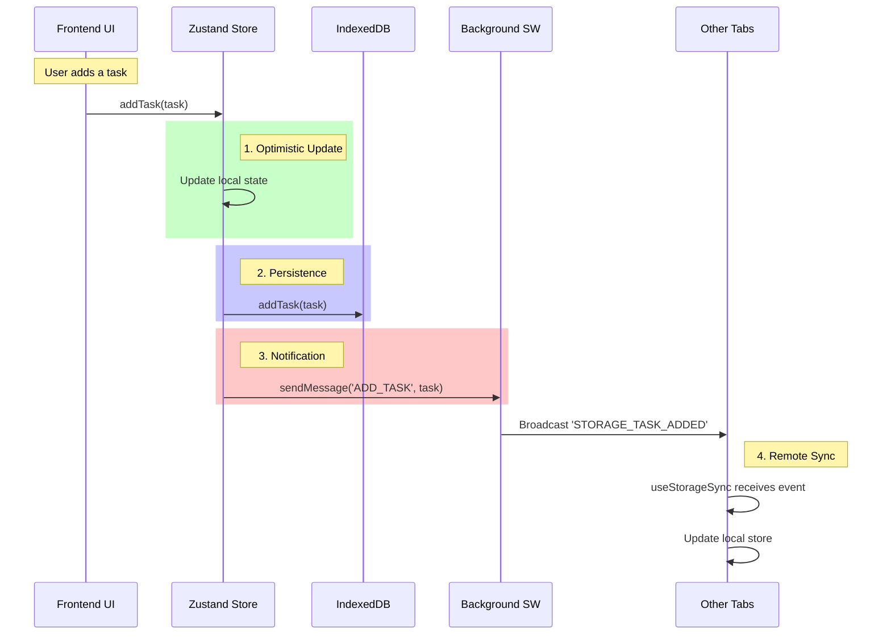

# Data Flow & Synchronization

## 🔄 Overview

TabPlex runs in two contexts: the **Frontend** (Popup, Side Panel, New Tab Page) and the **Background** (Service Worker). Keeping these in sync is critical.

We use a **Message-Based Synchronization** pattern. One source of truth (IndexedDB) is maintained by the active frontend, while the background orchestrates communication.

---

## 📡 Synchronization Mechanism

### The Sync Loop

### `useStorageSync` Hook

This hook is the heart of the frontend synchronization.

- **On Mount**: Loads all data from IndexedDB into the Zustand store.
- **On Event**: Listens for `chrome.runtime.onMessage` events (e.g., `STORAGE_TASK_UPDATED`) and updates the store _silently_ (without triggering a write back to DB, to avoid loops).

---

## 🛠️ Detailed Flows

### 1. Adding an Item (e.g., Tab)

1. **Component**: User clicks "Add Tab".
2. **TabSlice**:
    - Generates ID.
    - Updates `tabs` array in state.
    - Calls `addTabToDB(tab)`.
    - Sends `ADD_TAB` message to runtime.
3. **Background**:
    - `message-handler.ts` receives `ADD_TAB`.
    - Optionally performs background logic (e.g., if it needs to track open tabs).
    - Broadcasts change to other listeners.

### 2. Session Restore (Complex Flow)

1. **User**: Clicks "Restore" on a Session Card.
2. **SessionCard**: Calls `onRestore`.
3. **SessionsView**:
    - Iterates through `session.tabIds`.
    - Calls `chrome.tabs.create` for each URL.
    - Calls `addTab()` to register the new tab in TabPlex's store immediately.
    - **Note**: This ensures that even before the tab fully loads, TabPlex knows it belongs to the workspace.

---

## Replies and bulk operations

### Replies (`respondWith`)

Background handlers that answer asynchronously use `respondWith(work, sendResponse, options)` (`src/background/respond.ts`):

- Success sends `{ success: true }`, or whatever `map(value)` returns.
- A failure sends `{ error: <message> }`.
- A timeout sends `{ error }` too. It is never a made-up success: the UI must not believe a write happened that may not have.
- Only the first reply is sent. The handler returns `true` to keep the message channel open.

`broadcast(type, payload)` sends a `STORAGE_*` message to the other extension pages and ignores "no receiver".

### Import and restore (`IMPORT_ALL_DATA`)

1. `importData` checks the file (`utils/importValidation.ts`, shared with the background), keeps the current data as `tabplex_import_backup` / `tabplex_import_backup_at` in `chrome.storage.local`, and writes IndexedDB, the settings and the canvases. If writing fails it puts the previous data back (`applyWithRollback`).
2. It sends `IMPORT_ALL_DATA` so the background replaces its own copy and then broadcasts `STORAGE_DATA_IMPORTED`.
3. Other TabPlex tabs reload on `STORAGE_DATA_IMPORTED`. The importing tab ignores it (`isImportInThisTab`) and reloads itself after its success toast.
4. "Restore the data from before the last import" (Settings) runs the stored backup through the same flow, with the same rollback.

A file without the "Record every page I open" setting leaves the current value as it is.

### Clear All Data

`clearEverything` (`features/settings/utils/clearEverything.ts`) runs in the Settings tab only: it writes `tabplex_track_all_tabs: false`, removes every other `chrome.storage.local` key, clears IndexedDB and `localStorage`, empties the store and the Pomodoro state, and then sends `STORAGE_DATA_CLEARED`. The background ignores every `STORAGE_*` message, so the UI sends this one itself. Other TabPlex tabs reload (Chrome does not deliver a message to its sender), so they cannot write their old data back.

### Deleting a folder

`DELETE_FOLDER` carries `{ id, moveTabs?, targetFolderId? }`. The background moves the tabs to `targetFolderId || ''` (unfiled) or deletes them, deletes the folder, and broadcasts `STORAGE_FOLDER_DELETED` with `{ id, moveTabs, targetFolderId }`. Receivers call `deleteFolderSilently` with the same arguments; without them they would drop the moved tabs and then delete them from the shared IndexedDB.

---

## ⚠️ Race Conditions & Handling

- **Duplicate Events**: Unique IDs (`uuid` or timestamp-based) prevent duplicate creations. `useStorageSync` checks `if (!exists)` before adding.
- **Initial Load**: The app shows a loading state until `useStorageSync` confirms it has hydrated the store from IndexedDB.
- **Loops**: The "Silent" actions (`addTabSilently`, etc.) in the store are crucial. They update the UI state _without_ sending a message or writing to DB (assuming the event came from a DB write elsewhere).
